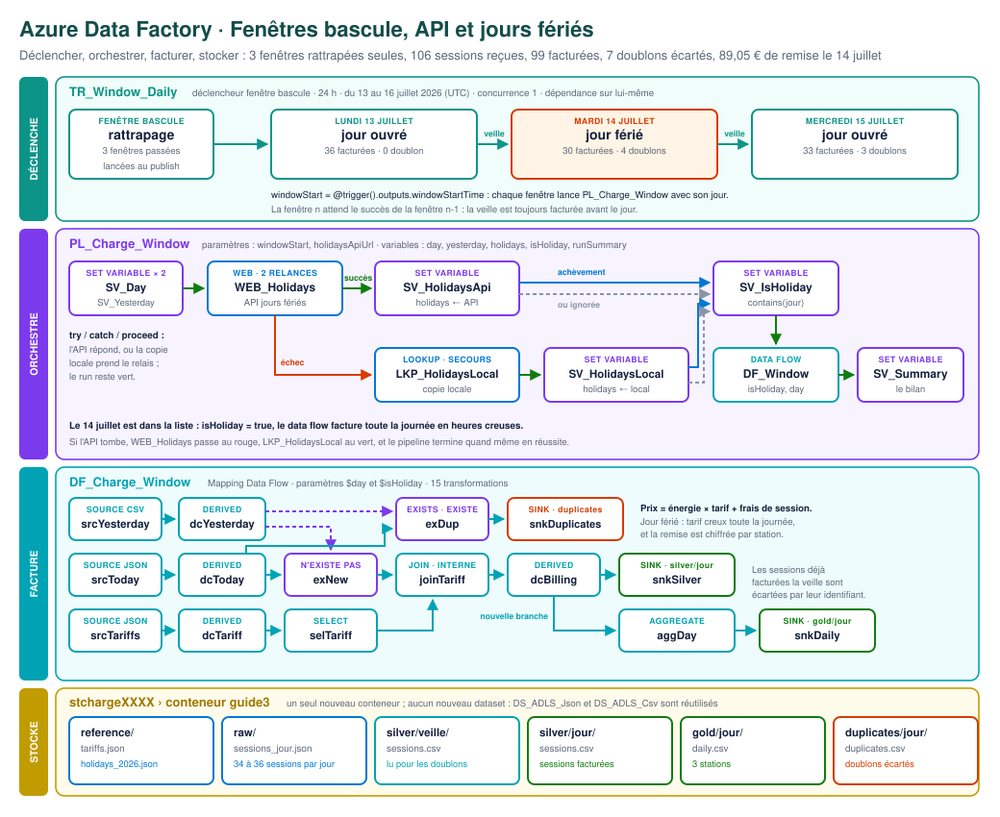
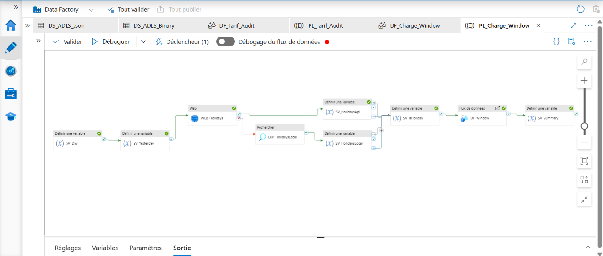
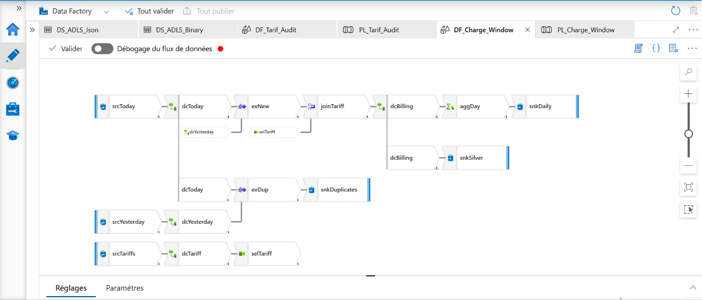
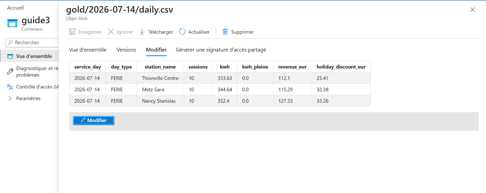
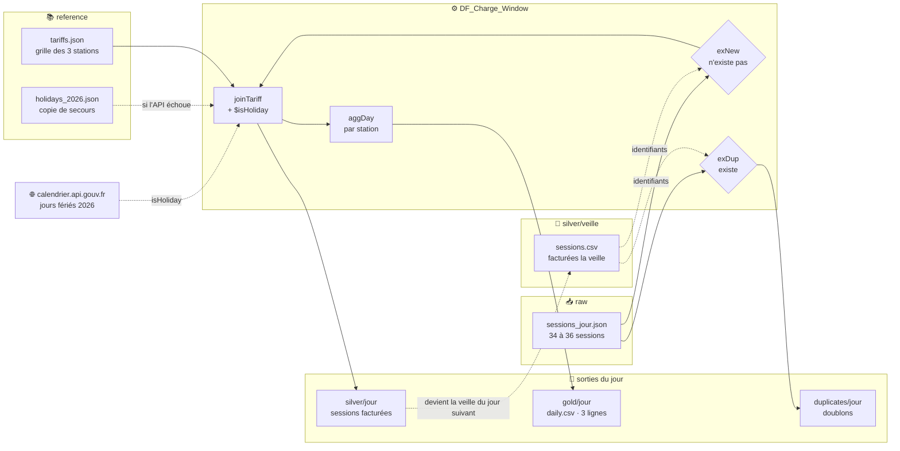

<a id="top"></a>

<div align="center">

# ⚡ Azure Data Factory · Guide n° 3 · Fenêtres bascule, API et jours fériés

**Un pipeline qui maîtrise le temps : un déclencheur à fenêtre bascule découpe les journées et rattrape seul le passé, chaque fenêtre interroge l'API officielle des jours fériés avec une copie locale en secours, écarte les sessions déjà facturées la veille, puis facture chaque recharge au bon tarif et chiffre la remise du 14 juillet.**


**[📘 Guide n° 3 pas à pas (PDF, 5 pages)](docs/Guide_ADF_Fenetre_Bascule_Public_3.pdf)** · **[📂 Données source](data/)** · **[🏗️ Architecture](#architecture)** · **[🚀 Reproduire](#reproduire)**

<br/>



<sub>Quatre couches, de haut en bas : ce qui déclenche, ce qui orchestre, ce qui facture, où vivent les données. Les nombres sont les volumes réellement observés à l'exécution.</sub>

</div>

---

## ⚡ En bref

| 📥 Entrée | ⚙️ Traitement | 📤 Sortie |
|:---:|:---:|:---:|
| **3 exports JSON** de sessions, un par jour du 13 au 15 juillet 2026, une **grille tarifaire** et l'**API publique** des jours fériés | **1 déclencheur à fenêtre bascule**, **1 pipeline** de 9 activités avec try / catch, **1 data flow Spark** de 15 transformations | **99 sessions facturées**, **7 doublons** isolés, **1 rapport par jour et par station**, **89,05 €** de remise chiffrée |

> **Série Azure Data Factory, guide n° 3.** Chaque guide de la série construit un pipeline complet, reproductible de bout en bout, avec ses données, son diagramme et son guide PDF. Ce guide prolonge le **[guide n° 1](https://github.com/abdoulhamiddiallo/adf-pipeline-express-1)** et le **[guide n° 2](https://github.com/abdoulhamiddiallo/adf-pipeline-express-2)** dans **exactement le même environnement Azure** : même groupe de ressources, même fabrique, même compte de stockage, mêmes datasets. Il n'ajoute qu'un conteneur, un data flow, un pipeline et un déclencheur.

---

## 🖼️ Aperçu

### Le pipeline `PL_Charge_Window`, exécuté avec succès

L'API a répondu : la branche de secours, `LKP_HolidaysLocal` puis `SV_HolidaysLocal`, est **omise** et non en échec. `SV_IsHoliday` s'exécute quand même grâce à ses quatre flèches « à l'achèvement » et « lors de l'omission ». C'est le motif *try / catch / proceed* d'Azure Data Factory.



### Le data flow `DF_Charge_Window`

Le jour (JSON), la veille (CSV) et la grille (JSON) entrent par trois sources. Deux transformations **Existe** partent côte à côte de `dcToday` : l'une garde les sessions nouvelles, l'autre isole les doublons. Une **jointure** apporte le tarif, puis deux branches écrivent le détail facturé et le rapport du jour.



### Le rapport du jour férié, `gold/2026-07-14/daily.csv`



---

<a id="resultats-cles"></a>

## 📊 Résultats clés

| Indicateur | Résultat |
|---|---|
| Fenêtres traitées | **3**, lancées **seules** au moment de la publication, **dans l'ordre** des jours |
| Sessions reçues | **106** : 36 le 13, 34 le 14, 36 le 15 |
| Sessions facturées | **99** : 36, 30 et 33 |
| Doublons écartés | **7** : sessions commencées tard le soir et renvoyées le lendemain |
| Lignes perdues | **0** : chaque jour, reçues = facturées + doublons (34 = 30 + 4, 36 = 33 + 3) |
| Jour férié détecté | **1** : le 14 juillet, reconnu par l'API `calendrier.api.gouv.fr` |
| Remise du jour férié | **89,05 €**, chiffrée station par station |
| Résilience | API coupée : le pipeline bascule sur la copie locale et finit en **Réussite** |
| Durée d'une fenêtre | environ **3 minutes** pour la première (démarrage de Spark), **moins de 40 secondes** pour les suivantes |
| Nouvelles ressources Azure | **0** |

**Le bilan écrit par le pipeline lui-même, dans la variable `runSummary`, une ligne par fenêtre :**

```text
Fenêtre 2026-07-13 (jour ouvré) : 36 sessions facturées, 0 doublons écartés
Fenêtre 2026-07-14 (jour férié) : 30 sessions facturées, 4 doublons écartés
Fenêtre 2026-07-15 (jour ouvré) : 33 sessions facturées, 3 doublons écartés
```

**Les trois rapports publiés dans `gold/<jour>/daily.csv` :**

| Jour | Type | Station | Sessions | kWh | dont heures pleines | Chiffre d'affaires (€) | Remise férié (€) |
|---|---|---|---:|---:|---:|---:|---:|
| 13 juillet | ouvré | Metz Gare | 12 | 299,81 | 196,68 | 127,51 | 0,00 |
| 13 juillet | ouvré | Nancy Stanislas | 12 | 296,34 | 230,00 | 138,41 | 0,00 |
| 13 juillet | ouvré | Thionville Centre | 12 | 347,21 | 234,80 | 139,54 | 0,00 |
| **14 juillet** | **férié** | Metz Gare | 10 | 344,64 | 0,00 | 115,29 | **32,38** |
| **14 juillet** | **férié** | Nancy Stanislas | 10 | 352,40 | 0,00 | 127,33 | **33,26** |
| **14 juillet** | **férié** | Thionville Centre | 10 | 353,63 | 0,00 | 112,10 | **23,41** |
| 15 juillet | ouvré | Metz Gare | 11 | 333,58 | 276,39 | 148,18 | 0,00 |
| 15 juillet | ouvré | Nancy Stanislas | 11 | 284,17 | 246,32 | 135,89 | 0,00 |
| 15 juillet | ouvré | Thionville Centre | 11 | 275,76 | 186,77 | 111,74 | 0,00 |

**Les trois journées côte à côte :**

| Jour | Reçues | Facturées | kWh livrés | Chiffre d'affaires | Remise férié | Doublons écartés |
|---|---:|---:|---:|---:|---:|---|
| Lundi 13 | 36 | 36 | 943,36 | 405,46 € | 0 € | aucun |
| **Mardi 14** | 34 | 30 | **1 050,67** | **354,72 €** | **89,05 €** | `MET-071311`, `MET-071312`, `NAN-071312`, `THI-071312` |
| Mercredi 15 | 36 | 33 | 893,51 | 395,81 € | 0 € | `MET-071410`, `NAN-071410`, `THI-071410` |

Le 14 juillet est à la fois le jour où les bornes ont livré **le plus d'énergie** et celui où le chiffre d'affaires est **le plus bas** : le tarif creux appliqué toute la journée a rendu 89,05 € aux clients.

---

## 💼 Impact métier

Un opérateur de bornes de recharge exploite trois stations en Lorraine : **Metz Gare**, **Nancy Stanislas** et **Thionville Centre**. Chaque borne envoie chaque jour un export JSON de ses sessions. Ce pipeline transforme ces exports en factures justes, jour après jour, sans intervention humaine.

- **Aucune session facturée deux fois.** Les sessions commencées tard le soir sont renvoyées le lendemain par les bornes. Le pipeline les reconnaît par leur identifiant et les range à part : 7 doubles facturations évitées en trois jours.
- **Le bon tarif au bon jour.** Le calendrier officiel de l'État décide si un jour est férié. Personne n'a à maintenir une liste à la main, et le 14 juillet est facturé en heures creuses du premier au dernier kWh.
- **Une remise chiffrée, pas devinée.** Le rapport indique, station par station, ce que le jour férié a coûté : 89,05 € le 14 juillet, dont 33,26 € à Nancy.
- **Un passé rejouable.** Une erreur découverte sur une journée ancienne ? On relance cette seule fenêtre : ses dossiers sont réécrits à l'identique, les autres jours ne bougent pas.
- **Une panne externe sans conséquence.** Si l'API du calendrier ne répond pas, la facturation continue avec la copie locale, et le run reste vert.
- **Un coût minimal.** Rien ne tourne en dehors des fenêtres, et la date de fin arrête le déclencheur toute seule.

---

## 🧭 Synthèse

Le guide n° 1 transformait, le guide n° 2 jugeait. Ce guide n° 3 **maîtrise le temps** :

1. **Il découpe le temps.** Un déclencheur à fenêtre bascule transmet au pipeline le début de chaque journée de 24 heures avec `@trigger().outputs.windowStartTime`.
2. **Il rattrape le passé.** Publié après coup, le déclencheur découvre que ses fenêtres du 13, du 14 et du 15 juillet sont passées et les lance seul.
3. **Il garantit l'ordre.** Une concurrence de 1 et une **dépendance sur lui-même** (décalage de -1 jour) interdisent au 14 de démarrer tant que le 13 n'a pas réussi : les doublons du 14 se calculent contre le 13.
4. **Il interroge une API externe.** Une activité **Web** appelle `calendrier.api.gouv.fr`, avec deux nouvelles tentatives espacées de 30 secondes.
5. **Il survit à sa panne.** Sur échec, une **Recherche** lit la copie locale. Quatre flèches « à l'achèvement » et « lors de l'omission » font converger les deux branches : c'est le motif *try / catch / proceed*.
6. **Il dédoublonne sans rien perdre.** La paire **Existe** / **N'existe pas** sépare le flux du jour en sessions nouvelles et en doublons.
7. **Il facture et chiffre.** Une **jointure** apporte la grille, un **paramètre booléen** `$isHoliday` bascule toute la journée au tarif creux, et un agrégat calcule la remise.

---

## ⚙️ Le pipeline

### Déclencheur `TR_Window_Daily`

| Réglage | Valeur | Pourquoi |
|---|---|---|
| Type | Fenêtre bascule (*Tumbling window*) | Traite des intervalles de temps, pas des instants |
| Début, fin (UTC) | 13/07/2026 00:00, 16/07/2026 00:00 | Trois fenêtres exactement, puis arrêt automatique |
| Périodicité | 24 heures | Une fenêtre par journée |
| Concurrence maximale | 1 | Une seule journée à la fois |
| Nouvelle tentative | 1, intervalle 30 s | Absorbe un incident passager |
| Dépendance | lui-même, décalage `-1.00:00:00`, taille `1.00:00:00` | La veille avant le jour |
| Paramètre transmis | `windowStart = @trigger().outputs.windowStartTime` | Le pipeline sait quel jour il traite |

### Pipeline `PL_Charge_Window`

Deux paramètres : `windowStart` et `holidaysApiUrl`. Cinq variables : `day`, `yesterday`, `holidays`, `runSummary` (String) et `isHoliday` (Boolean).

| # | Activité | Type (nom dans l'interface en français) | Rôle |
|:-:|---|---|---|
| 1 | `SV_Day` | Set variable (Définir une variable) | Le jour de la fenêtre, au format `yyyy-MM-dd` |
| 2 | `SV_Yesterday` | Set variable | La veille, avec `addDays(windowStart, -1)` |
| 3 | `WEB_Holidays` | Web | `GET` sur l'API des jours fériés, 2 nouvelles tentatives |
| 4a | `SV_HolidaysApi` | Set variable | Branche succès : la réponse de l'API dans `holidays` |
| 4b | `LKP_HolidaysLocal` | Lookup (Recherche) | Branche échec : la copie locale `holidays_2026.json` |
| 4c | `SV_HolidaysLocal` | Set variable | La copie locale dans `holidays` |
| 5 | `SV_IsHoliday` | Set variable | Point de convergence : le jour est-il dans la liste ? |
| 6 | `DF_Window` | Data flow (Flux de données) | Exécute `DF_Charge_Window` avec `$day` et `$isHoliday` |
| 7 | `SV_Summary` | Set variable | Le bilan de la fenêtre en une phrase |

### Data flow `DF_Charge_Window`

Deux paramètres : `day` (string) et `isHoliday` (boolean).

| Étape | Transformation | Ce qu'elle fait |
|---|---|---|
| `srcToday` | Source JSON | Lit `raw/sessions_<jour>.json`, *Tableau de documents*, schéma découvert à l'exécution |
| `dcToday` | Derived column | Type l'identifiant, la station, l'heure de début et l'énergie avec `byName()` |
| `srcYesterday` | Source CSV | Lit les sessions facturées la veille dans `silver/<veille>` |
| `dcYesterday` | Derived column | Extrait l'identifiant `y_sid` |
| `srcTariffs` · `dcTariff` · `selTariff` | Source JSON, Derived column, Select | La grille typée, réduite à six colonnes |
| `exNew` | Exists, *N'existe pas* | Les sessions jamais vues la veille |
| `exDup` | Exists, *Existe*, nouvelle branche | Les doublons, isolés pour être tracés |
| `joinTariff` | Join, interne | Ajoute à chaque session la grille de sa station |
| `dcBilling` | Derived column | Période tarifaire, prix facturé, prix d'un jour ouvré, jour, type de jour |
| `aggDay` | Aggregate, nouvelle branche | Sessions, kWh, kWh en heures pleines, chiffre d'affaires et remise par station |
| `snkSilver` · `snkDaily` · `snkDuplicates` | Sink | `silver/<jour>/sessions.csv`, `gold/<jour>/daily.csv`, `duplicates/<jour>/duplicates.csv` |

### Les expressions qui font le travail

**La convergence du try / catch**, dans `SV_IsHoliday` : la variable `holidays` a été remplie soit par l'API, soit par la copie locale.

```text
@contains(json(variables('holidays')), variables('day'))
```

**Le prix facturé**, dans `dcBilling` : un jour férié, toute la journée passe au tarif creux.

```text
round(energy * iif($isHoliday, offpeak_eur, iif(start_hour >= peak_start && start_hour < peak_end, peak_eur, offpeak_eur)) + session_fee, 2)
```

**La remise du jour férié**, dans `aggDay` : ce qu'un jour ouvré aurait coûté, moins ce qui a été facturé.

```text
round(sum(workday_eur) - sum(billed_eur), 2)
```

**Les chemins de la fenêtre**, dans `DF_Window` : chaque fenêtre lit son jour et sa veille, et n'écrit que dans ses propres dossiers.

```text
@concat('sessions_', variables('day'), '.json')
@concat('silver/', variables('yesterday'))
@concat('gold/', variables('day'))
```

### Les choix qui font la différence

- **Une fenêtre bascule plutôt qu'une planification.** Un déclencheur planifié ne connaît que « maintenant ». La fenêtre bascule connaît des intervalles : elle transmet le début de chaque journée, rattrape le passé et relance une fenêtre précise à la demande.
- **Une dépendance sur lui-même.** Le dédoublonnage du 14 a besoin de la facturation du 13. L'ordre n'est pas un confort, c'est une condition de justesse.
- **Un échec rattrapé n'est pas un échec.** `WEB_Holidays` n'est pas une activité terminale : quand la branche de secours réussit, le pipeline finit en **Réussite**.
- **Exists plutôt qu'une jointure pour dédoublonner.** Exists ne rapporte aucune colonne, il teste seulement la présence. Sa paire Existe / N'existe pas sépare le flux sans rien dupliquer.
- **Un jour zéro.** Le fichier `silver/2026-07-12/sessions.csv`, réduit à son en-tête, donne à la première fenêtre une veille vide au lieu d'un chemin introuvable.
- **Des écritures idempotentes.** Chaque récepteur efface son dossier avant d'écrire : rejouer une fenêtre produit exactement le même résultat.
- **Des paramètres partout.** L'URL de l'API est un paramètre du pipeline : on peut tester la panne sans toucher au code.

---

## 🔗 Lignage des données



| Dossier de `guide3` | Contenu | Format | Volume sur les 3 jours |
|---|---|---|---|
| `reference` | La grille tarifaire et la copie des jours fériés | JSON | 3 stations, 11 jours fériés |
| `raw` | Les exports des bornes, un fichier par jour | JSON | 106 sessions |
| `silver/<jour>` | Les sessions facturées, avec période, prix et type de jour | CSV | 99 lignes |
| `gold/<jour>` | Le rapport du jour par station | CSV | 9 lignes |
| `duplicates/<jour>` | Les sessions déjà facturées la veille | CSV | 7 lignes |

---

<a id="architecture"></a>

## 🏗️ Architecture

Le diagramme complet ouvre cette page, [tout en haut](#top). Il se lit de haut en bas, en quatre couches : **ce qui déclenche**, **ce qui orchestre**, **ce qui facture** et **où vivent les données**. [Ouvrir le diagramme en grand](docs/images/architecture.svg).

> **Même environnement que les guides n° 1 et n° 2.** Rien n'est recréé : le groupe de ressources, la fabrique, le compte de stockage, l'identité managée, le service lié et les datasets sont réutilisés tels quels.

| Ressource | Nom | Statut dans ce guide |
|---|---|---|
| Groupe de ressources | `rg-adf-charge` | Réutilisé |
| Compte de stockage ADLS Gen2 | `stchargeXXXX` | Réutilisé, avec un nouveau conteneur `guide3` |
| Data Factory V2 | `adf-charge-XXXX` | Réutilisée |
| Identité managée | celle de la fabrique | Réutilisée, rôle **Storage Blob Data Contributor** |
| Linked service | `LS_ADLS_Charge` | Réutilisé |
| Datasets | `DS_ADLS_Csv`, `DS_ADLS_Json` | Réutilisés |
| Data flow | `DF_Charge_Window` | **Nouveau** |
| Pipeline | `PL_Charge_Window` | **Nouveau** |
| Déclencheur | `TR_Window_Daily` | **Nouveau**, fenêtre bascule |
| API externe | `calendrier.api.gouv.fr` | Publique, sans clé |

---

## 🧰 Stack technique

| Domaine | Technologie |
|---|---|
| Déclenchement | Déclencheur à fenêtre bascule : rattrapage, concurrence, nouvelle tentative, dépendance sur lui-même |
| Orchestration | Azure Data Factory V2 : Web, Lookup, Set variable, Data flow, paramètres de pipeline, variable booléenne |
| Résilience | Nouvelles tentatives, chemins « en cas d'échec », « à l'achèvement » et « lors de l'omission » |
| Transformation | Mapping Data Flow sur Spark : sources JSON et CSV, Derived column, Exists, Join, Select, Aggregate, paramètres string et boolean |
| Intégration | API REST publique `calendrier.api.gouv.fr` |
| Stockage | Azure Data Lake Storage Gen2, conteneur `guide3` : reference, raw, silver, gold, duplicates |
| Sécurité | Identité managée, Microsoft Entra ID, contrôle d'accès en fonction du rôle (RBAC) |

---

<a id="reproduire"></a>

## 🚀 Reproduire le projet

Tout est fourni pour refaire ce pipeline dans votre propre abonnement Azure. Le compte gratuit suffit.

1. Faites d'abord les étapes 1 et 2 du **[guide n° 1](https://github.com/abdoulhamiddiallo/adf-pipeline-express-1)**, puis l'étape 2 du **[guide n° 2](https://github.com/abdoulhamiddiallo/adf-pipeline-express-2)** : elles créent l'environnement et les datasets que ce guide réutilise.
2. Téléchargez le **[guide n° 3 pas à pas (PDF, 5 pages)](docs/Guide_ADF_Fenetre_Bascule_Public_3.pdf)**. Chaque valeur à saisir y figure dans un bloc à copier, et chaque choix est expliqué.
3. Téléchargez les six fichiers du dossier **[`data/`](data/)**. Ils sont aussi joints dans le PDF.
4. Suivez les sept étapes : préparer le conteneur, construire le data flow puis le pipeline, créer le déclencheur, vérifier, couper l'API pour éprouver le secours, puis **tout fermer**.
5. Comparez vos `daily.csv` aux tableaux de la section [Résultats clés](#resultats-cles) : les chiffres doivent être identiques.

> **Astuce.** Dans ADF Studio en français : Web est dans la catégorie **Général**, Exists s'appelle **Existe**, Join **Jointure**, Aggregate **Agréger**, et le déclencheur Tumbling window **Fenêtre bascule**.

### Structure du dépôt

```text
adf-pipeline-express-3/
├── README.md
├── data/
│   ├── reference/
│   │   ├── tariffs.json                 grille des 3 stations
│   │   └── holidays_2026.json           copie de secours des jours fériés
│   ├── raw/
│   │   ├── sessions_2026-07-13.json     lundi : 36 sessions
│   │   ├── sessions_2026-07-14.json     mardi, férié : 34 sessions, dont 4 renvoyées
│   │   └── sessions_2026-07-15.json     mercredi : 36 sessions, dont 3 renvoyées
│   └── silver/
│       └── 2026-07-12/
│           └── sessions.csv             le jour zéro : l'en-tête seul
└── docs/
    ├── Guide_ADF_Fenetre_Bascule_Public_3.pdf
    └── images/
        ├── architecture.svg
        ├── pipeline.png
        ├── data-flow.png
        └── gold-jour-ferie.png
```

Déposez chaque fichier dans le dossier de même nom du conteneur `guide3`.

### Les sessions `raw/sessions_<jour>.json`

Un tableau de documents JSON, une session par document :

```json
{
  "session_id": "MET-071311",
  "station": "Metz Gare",
  "charger_id": "MET-B5",
  "start_time": "2026-07-13 21:21:00",
  "energy_kwh": 32.99
}
```

| Champ | Description |
|---|---|
| `session_id` | Identifiant unique de la session : station, jour, numéro. C'est la clé du dédoublonnage |
| `station` | Nom de la station, clé de jointure avec la grille |
| `charger_id` | Borne utilisée |
| `start_time` | Début de la session : son heure fixe la période tarifaire |
| `energy_kwh` | Énergie délivrée, en kWh |

### La grille tarifaire `reference/tariffs.json`

| Station | Heures pleines (€/kWh) | Heures creuses (€/kWh) | Plage pleine | Frais de session (€) |
|---|---:|---:|---|---:|
| Metz Gare | 0,45 | 0,32 | 7 h à 21 h | 0,50 |
| Nancy Stanislas | 0,48 | 0,35 | 7 h à 21 h | 0,40 |
| Thionville Centre | 0,42 | 0,30 | 8 h à 20 h | 0,60 |

### Les jours fériés `reference/holidays_2026.json`

Une copie exacte de la réponse de `https://calendrier.api.gouv.fr/jours-feries/metropole/2026.json` : un objet dont les clés sont les dates, par exemple `"2026-07-14": "14 juillet"`. Le pipeline ne la lit que si l'API ne répond pas.

---

## ✅ Conclusion

Ce pipeline réunit ce qui distingue un traitement de production d'une démonstration : il **traite le temps par intervalles**, **rattrape le passé** sans intervention, **garantit l'ordre** des jours, **dialogue avec une API externe** et **survit à sa panne**. Il **dédoublonne sans rien perdre** et **facture au bon tarif** chaque jour, férié compris. Chaque session reçue est soit facturée, soit isolée comme doublon, et le pipeline le prouve lui-même dans son bilan.

Rejouer une journée réécrit ses seuls dossiers, à l'identique. Ajouter un jour ne demande qu'un fichier de plus dans `raw` et une date de fin plus lointaine. Le pipeline, lui, ne change pas.

---

## 💡 Le mot de la fin

> Un bon pipeline ne se contente pas de traiter des données. Il sait quel jour il traite, il attend que la veille soit faite, et quand le monde extérieur lui fait défaut, il a toujours un plan B.

**Construire pour explorer. Explorer pour comprendre. Et apprendre en chemin.**

---

<div align="center">

**Abdoul Hamid Diallo**
Microsoft Certified : Fabric Data Engineer Associate · Fabric Analytics Engineer Associate · Power BI Data Analyst Associate · Azure AI Engineer Associate · Azure Data Scientist Associate

[](https://www.linkedin.com/in/abdoul-hamid-diallo-fabric-data-engineer/)
[](https://github.com/abdoulhamiddiallo)

<sub>[⬆ Retour en haut](#top)</sub>

</div>
